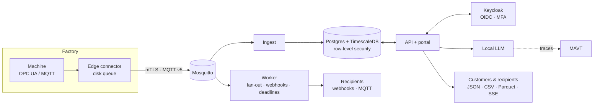

<p align="center">
  
</p>

<h1 align="center">🏭 Data Act Kit</h1>

<p align="center">
  <strong>EU Data Act compliance for machine makers: self-hosted and enforced in code.</strong><br />
  Catalogue your machine data, connect machines securely, and give customers and the third parties they choose lawful, logged access.
</p>

<p align="center">
  <a href="https://github.com/hit1001/Data-Act-Kit/actions/workflows/ci.yml"></a>
  
  
  
  <a href="./LICENSE"></a>
</p>

<p align="center">
  <a href="#-quick-start">Quick Start</a> ·
  <a href="#-features">Features</a> ·
  <a href="#-architecture">Architecture</a> ·
  <a href="#-connect-a-machine">Connect a machine</a> ·
  <a href="#-requirements-traceability">Traceability</a> ·
  <a href="#%EF%B8%8F-roadmap">Roadmap</a>
</p>

---

> **From 12 September 2025, machine data belongs to the people who use the machine as well as the maker.**

The EU Data Act (Regulation (EU) 2023/2854) obliges makers of connected products to describe the
data their machines produce. Customers must be able to get that data without undue delay, and so
must third parties the customer chooses. Makers must also protect trade secrets, refuse
gatekeepers and treat recipients without discrimination. **Data Act Kit** turns these obligations
into software you run yourself. It enforces the rules on every request instead of leaving them in
a policy document.

## 🎯 The Problem

A machine maker receives its first Data Act request. They need to answer:

- **Which data** does this machine model produce, and is it described the way Art. 3 requires?
- **Who is allowed** to read it: the customer, a service partner, a competitor, a gatekeeper?
- **Which data points are trade secrets**, and what has to be in place before they are shared?
- **What can be charged** to a third party, and how is that calculated?
- **Can we prove** that every access was lawful and every request was answered in time?

**Data Act Kit answers each of these from recorded facts, and logs every access it allows.**

## ✨ Features

| Capability | What it does |
| --- | --- |
| 📚 **Data catalogue** | Import a model's OPC UA NodeSet2 or a tag-list CSV. AI drafts the descriptions and a reviewer approves each data point. Catalogues are published as versioned JSON snapshots |
| 🧭 **Applicability check** | Works out from company size and placing-on-market dates whether and when Chapter II applies (Arts. 7 and 50), including the Art. 3(1) access-by-design date |
| 🛡️ **Deny-by-default access check** | One pure function decides every read. It checks machine ownership, grants, accepted terms, channel, OAuth scope, NDAs for trade secrets, a legal basis for personal data, and gatekeepers. It is covered by property tests |
| 🔐 **Trade-secret protection** | Trade-secret readings are encrypted with AES-256-GCM using per-data-point keys (envelope encryption). They are shared only under an accepted NDA |
| 🤝 **Contracts and grants** | Offer, approve and accept contracts. Grants are bound to a recipient category, its terms and its channels, and revoking one cuts off API, MQTT and webhook delivery |
| 💶 **Art. 9 compensation** | Quotes broken down into cost components, capped at cost for SMEs, with the calculation basis kept for transparency |
| 📬 **Requests and deadlines** | Requests follow a state machine and refusals are limited to the Act's grounds. Alerts fire at 50% and 90% of the deadline. Decision letters and authority notices are drafted for you |
| 📄 **Accessible documents** | Pre-contract information, terms, NDAs and decision letters are generated as tagged PDF/UA from lawyer-approved templates |
| 📡 **Many ways out** | JSON, CSV and Parquet exports with a per-recipient fingerprint, live SSE streams, HMAC-signed webhooks and per-grant MQTT topics |
| ⚖️ **Non-discrimination report** | Compares terms and compensation across recipients of the same category (Art. 8) |
| 🏭 **Edge connector** | Reads OPC UA or a gateway's MQTT without writing to the machine. A disk queue survives outages, and readings go out over mutual TLS and are delivered at least once |
| 🔍 **AI observability** | Every AI drafting call is traced to [MAVT](https://github.com/hit1001/multiagent-visibility-tool) |

## 🏗️ Architecture



| Package | Role |
|---|---|
| [`packages/core`](packages/core) | Pure domain logic with no I/O: access check, applicability, compensation, request rules, encryption, validation |
| [`packages/server`](packages/server) | Schema and migrations, API, ingest, worker, catalogue, documents, web portal |
| [`packages/edge`](packages/edge) | Edge connector for the factory network |
| [`deploy`](deploy) | Docker Compose stack, Mosquitto, Keycloak realm, secret and certificate scripts |

TypeScript runs directly on Node.js 24 (type stripping) and is checked in strict mode. There is no build step.

## 🚀 Quick Start

### Requirements

- **Docker** with the Compose plugin
- **Node.js 24 or newer**, only needed to run the tests outside Docker

### 1. Decisions the kit will not make for you

The services refuse to start until these are set. They are legal decisions, so take them with counsel:

| Setting | Where |
|---|---|
| `ACCESS_LOG_RETENTION_DAYS` (Art. 4(5)) | `deploy/app.env` |
| `REQUEST_DEADLINE_HOURS` ("without undue delay") | `deploy/app.env` |
| Gatekeeper list with source and review date (Art. 5(3)) | `config/gatekeepers.json` (copy the example) |
| Document templates, with recorded approval | `templates/*.json`, see [templates/README.md](templates/README.md) |
| Competent authority named in each model's related-service facts (Art. 3(3)) | portal → Catalogue |

No templates ship with the kit. Until you add them, the kit reports "no approved template" instead of generating documents.

### 2. Start the stack

```bash
git clone https://github.com/hit1001/Data-Act-Kit.git && cd Data-Act-Kit
deploy/scripts/init-secrets.sh            # keys, passwords, CA and broker certificate
cp config/gatekeepers.example.json config/gatekeepers.json
export LLM_IMAGE=<pinned llama.cpp server image> LLM_MODELS_DIR=$HOME/models LLM_MODEL_FILE=<model.gguf>
docker compose -f deploy/docker-compose.yml up -d db keycloak mosquitto mavt
```

### 3. Connect MAVT and create the first administrator

1. Open MAVT at **http://localhost:4242** (password in `deploy/secrets/mavt_password`). Create an API key and save it to `deploy/secrets/mavt_api_key`.
2. In Keycloak at **http://localhost:8081** (admin password in `deploy/secrets/keycloak_admin_password`), create your user in realm `dataact` and copy its id. Then run:

```bash
docker compose -f deploy/docker-compose.yml run --rm \
  -e MAKER_NAME="Maker GmbH" -e MAKER_SIZE=medium -e MAKER_MEDIUM_SINCE=2019-01-01 \
  -e ADMIN_OIDC_SUB=<keycloak user id> api node packages/server/src/bin/bootstrap.ts
docker compose -f deploy/docker-compose.yml up -d
```

### 4. Sign in

Open **http://localhost:8080**. Staff, customers and recipients are created in Keycloak and
registered under *Administration*. Every user sets up a one-time-password app on first sign-in.

**Machine clients**, meaning recipients that use OAuth client credentials, are confidential
Keycloak clients registered as principals with *Machine client: Yes*. Each grant adds the scope
`grant:<id>` to the client, and the API requires that scope.

## 🔌 Connect a machine

1. **Catalogue**: import the model's NodeSet2 XML or a CSV with the header
   `name,source_address,dtype[,unit_ucum][,rate_hz][,description]`. Draft descriptions with AI,
   review each data point and publish.
2. **Register** the machine and its edge device under *Machines*. The device id is the certificate CN.
3. **Issue a certificate**: `deploy/scripts/device-cert.sh <device-id>`
4. **On the factory PC**: copy `deploy/edge/edge.example.json` to `edge.json` and map each data
   point to its OPC UA node or gateway MQTT topic. Put `ca.crt` and the device certificate in
   `deploy/edge/certs/`, then run:

```bash
docker compose -f deploy/edge/docker-compose.yml up -d
```

An MQTT source topic carries a number, a boolean, a string, or JSON `{ "value": … }`.

## 🔒 Security model

- **Every read goes through one access check** (`decide()` in `packages/core`). It denies anything
  not explicitly allowed and returns a reason code for every denial.
- **Tenant isolation in the database**: row-level security is forced on machines and readings, so
  a query bug cannot leak another organisation's data.
- **Devices** authenticate with client certificates. The broker ACL ties each certificate to its
  own topic only.
- **Trade secrets** are encrypted at rest, and data keys are wrapped by a key-encryption key.
- **Webhooks** are HTTPS only and HMAC-signed. The grant is re-checked before every delivery.
- **Accesses are logged** for the retention period your counsel sets.

## ✅ Requirements traceability

Each requirement R1–R16 in the design maps to tests in
[test/traceability.json](test/traceability.json). CI builds a traceability matrix and **fails if
any requirement lacks passing evidence**. R5 (no manipulative interface) is the one exception: it
is evidenced by the signed checklist in [docs/ui-review.md](docs/ui-review.md).

```bash
npm run check     # strict typecheck + unit and property tests, no Docker needed
npm run test:it   # end-to-end against real TimescaleDB and Mosquitto (Docker)
npm run test:tap && npm run test:it && npm run trace   # what CI runs → traceability-matrix.md
```

## 🗺️ Roadmap

Implemented: milestones M1–M5 of the technical design. Next, for production:

- [ ] Helm chart, pgBackRest backups with restore tests, OpenTelemetry / Prometheus / Grafana
- [ ] k6 load test at twice the pilot load
- [ ] Vault or cloud-KMS key-encryption key (the `KeyEncryptionKey` interface is ready)
- [ ] Asset Administration Shell export and dataspace connectors
- [ ] AI drafting of plain-language document sections

## 🤝 Contributing

```bash
npm ci
npm run check
```

Keep `packages/core` free of I/O, add a test named after its requirement id for every rule you
change, and map it in `test/traceability.json`.

## 📄 License

Data Act Kit is distributed under a **dual-license arrangement** (see [LICENSE](./LICENSE)):

- **Free (MIT terms):** individuals, teams under 10 people, open-source projects and evaluation.
- **Commercial licence:** organisations of 10 or more people, or use in a revenue-generating
  product or hosted service. To get one, [open an issue](https://github.com/hit1001/Data-Act-Kit/issues).

**Please review the actual license before using Data Act Kit commercially.** Its additional
restrictions mean the project should not be described as unmodified MIT-licensed or OSI-approved
open-source software. Files taken from [MAVT](https://github.com/hit1001/multiagent-visibility-tool)
remain under MAVT's license.

## ⚠️ Disclaimer

Data Act Kit is software, not legal advice. It enforces the decisions you record, and those
decisions (templates, gatekeeper list, retention period, deadlines) must come from qualified counsel.
